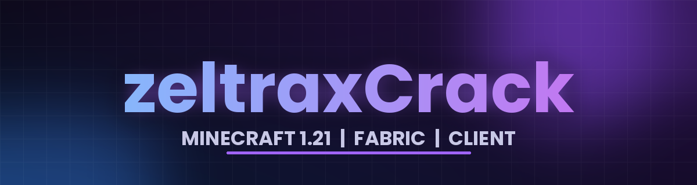

<p align="center">
  
</p>

<p align="center">
  <b>zeltraxCrack</b> - Minecraft Fabric client for 1.21 / 1.21.1
</p>

---

## Bilgi / Information

- Minecraft: Fabric 1.21 (1.21.1 ile de acilir / also loads on 1.21.1)
- ClickGUI tusu / key: `P`
- Komut oneki / command prefix: `@`
- Modulu baglamak icin ustune orta tik / middle click a module to bind it
- Surum / version: V15

## Gereksinimler / Requirements

- Fabric Loader + Fabric API (1.21)
- Java 21+

## Kurulum / Install

1. Actions sekmesinden en son yesil calismanin **Artifacts** bolumunden `zeltraxCrack` dosyasini indir.
2. Zip'ten `zeltraxCrack.jar` dosyasini cikar ve `mods` klasorune koy.
3. Eski surum jar dosyalarini `mods` klasorunden sil.

## Derleme / Build

```
./gradlew build
```

Cikti / output: `build/libs/zeltraxCrack.jar` (Java 21 gerekir). GitHub Actions her push'ta otomatik derler.

## Ozellikler / Features

- ElytraTarget, ElytraHelper, Aura, AutoTotem ve cok sayida savas / hareket / gorsel modulu
- Yeniden tasarlanmis ClickGUI ve ozel ana menu
- Zeltrix HUD paketi: Watermark, TargetHud, Keybinds
- Ozel acma / kapama / menu sesleri

## Krediler / Credits

Bu proje GPL-3.0 lisansli [ThunderHack-Recode](https://github.com/Pan4ur/ThunderHack-Recode) (pan4ur) tabanlidir.

- [meteordevelopment](https://github.com/MeteorDevelopment) - orbit
- [ladysnake](https://github.com/Ladysnake) - satin
- [0x3C50](https://github.com/0x3C50) - renderer

## Lisans / License

GPL-3.0. Kaynak kodu bu lisans kosullariyla dagitilir.
